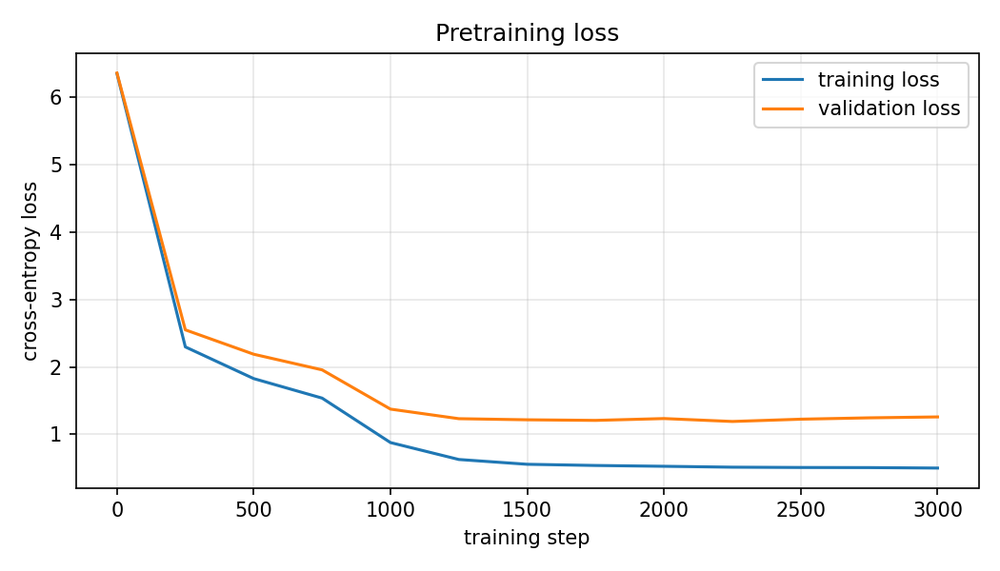
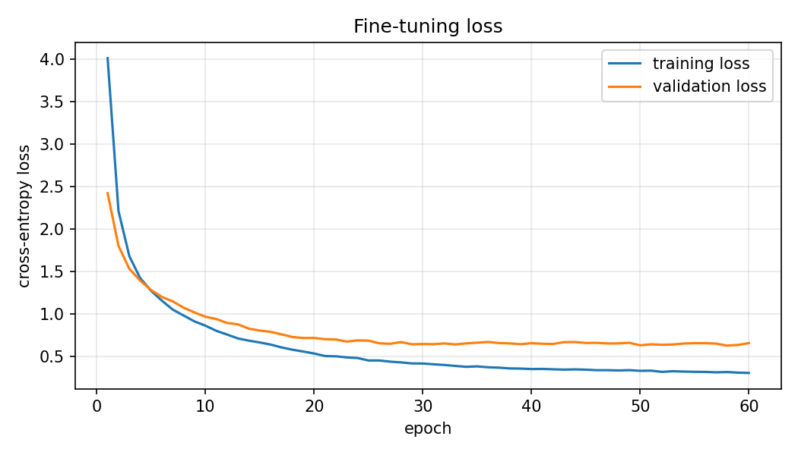
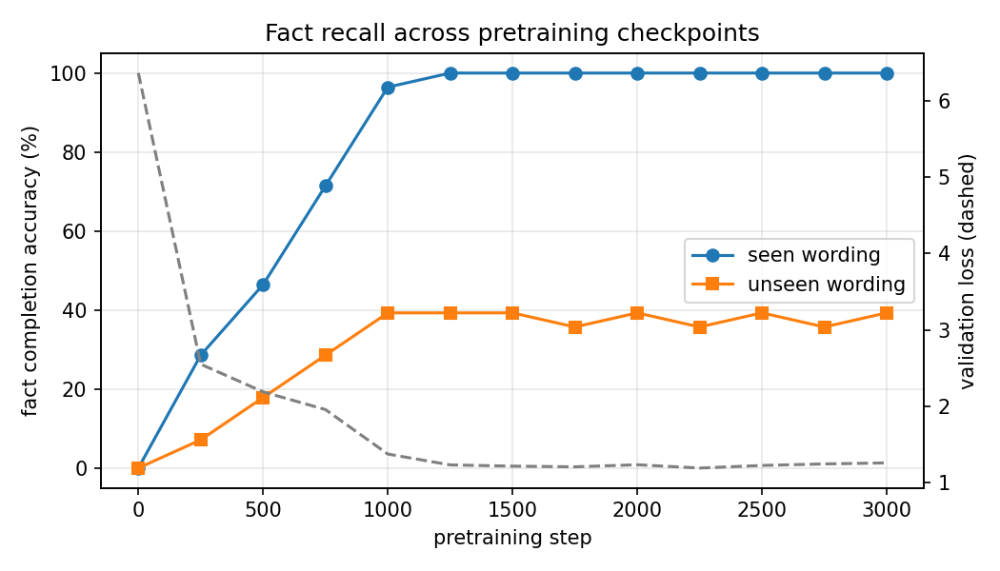

# Building and Investigating a Small Transformer Language Model

**CS 5370 Group Project, Fall 2026**

Group members: _[add the four names here]_

## 1. Introduction

We built a small decoder-only Transformer language model from scratch in PyTorch, trained it
on a synthetic corpus about a fictional university department, and then fine-tuned it to
answer questions. The model has about 0.93 million parameters and was trained entirely on a
4-core laptop CPU.

Our research question is:

> **How reliably can a small Transformer reproduce the facts of its training corpus, how does
> this ability develop during training, and does it depend on whether the prompt uses a
> wording the model saw in training?**

The short answer: the model reproduces all 28 facts perfectly when the prompt uses a familiar
wording (28/28), but only 11 of 28 when the same fact is asked for with a new wording. Recall
with familiar wordings grows steadily during training, while recall with new wordings stops
improving early. The same pattern appears again after fine-tuning for question answering.

## 2. Fictional Domain and Dataset

### 2.1 Knowledge base

Our fictional organization is **Cedar Ridge University**. Following the project guidelines, we
limited the project to one department: the **Laptop Loan Desk**, which lends laptops to
students. The knowledge base contains **28 facts**. Examples:

| Fact | Value |
|------|-------|
| Location of the desk | room 114 of Hollis Library |
| Weekday hours | 8 am to 6 pm |
| Desk manager | Dana Whitfield |
| Standard loan period | 14 days |
| Late fee | $5 per day (maximum $75) |
| Replacement cost of a lost laptop | $900 |
| Reservation portal | LoanPort |
| Damage must be reported within | 48 hours |

The full list is in `data/knowledge_base.md` and `facts.py`.

### 2.2 How the corpus was generated

We used a generative AI tool (Claude) to write the knowledge base and, for every fact,
**8 different sentences** that express the same fact in different words. For example, the
late fee appears as "The late fee for an overdue laptop is $5 per day", "Each overdue day
costs the student $5", "Late returns are charged at a rate of $5 per day", and so on. The AI
also wrote the material for **five document types**: policies, staff emails, student notices,
reports, and student guides. Each type has its own openings, closings, and short starter
phrases (for example "Please remember that" in a staff email or "According to this policy,"
in a policy).

A script (`1_make_dataset.py`) then builds the documents. Each document picks a random
document type, an opening, 4 to 8 random facts with a random wording for each, sometimes a
starter phrase, and a closing. This way the number of facts stays small and fixed, but every
fact appears thousands of times in many different contexts. No new facts can appear, because
all sentences come from the fixed knowledge base.

### 2.3 Partitions

| Partition | Documents | Tokens |
|-----------|-----------|--------|
| Training | 4,000 | 392,149 |
| Validation | 250 | 25,026 |
| Test | 250 | 25,827 |

To keep the evaluation data separate from the training data we did two things. First, no
document appears in more than one partition. Second, for every fact **one of the 8 wordings
is held out**: it is never used in training documents and only appears in validation and
test documents. So the validation and test sets contain sentences the model has never seen,
and they also contain a few words that are not in the vocabulary (about 0.5% of the tokens).

## 3. Tokenization and Vocabulary

We use a **word-level tokenizer**. The text is lowercased and split into words, numbers, and
single punctuation marks, so "The fee is $5." becomes `the`, `fee`, `is`, `$`, `5`, `.`. We
chose this because our corpus has a small, closed vocabulary, and with word tokens a whole
document (about 100 tokens) fits into the context window. A character-level tokenizer would
need much longer sequences, which would be slow on a CPU.

The vocabulary is built from the training documents and the fine-tuning questions and
answers. It contains **483 tokens**, including three special tokens: `<pad>` (fills short
sequences in a batch), `<unk>` (replaces unknown words), and `<eos>` (end of a document or
answer). Each token's ID is its position in the sorted vocabulary list. Encoding maps words to
IDs and decoding maps IDs back to words and joins them.

**Vocabulary size and model dimensions.** The vocabulary size V = 483 sets the size of two
parts of the model. The token embedding matrix has one row per token, so it has shape
V × d_model = 483 × 128 (61,824 parameters). The LM head must produce one logit for every
token, so its weight matrix has shape d_model × V = 128 × 483, plus 483 biases (62,307
parameters). A bigger vocabulary would make both of these larger, and it would also make the
prediction task harder because the softmax has to choose between more tokens.

The main weakness of a word-level tokenizer is that any word outside the vocabulary becomes
`<unk>`. We discuss this in the limitations.

## 4. Model Architecture

The model is a decoder-only Transformer, implemented in `slm.py`.

| Setting | Value |
|---------|-------|
| Decoder blocks | 4 |
| Attention heads per block | 4 |
| Embedding dimension (d_model) | 128 |
| Head dimension | 32 |
| Feed-forward hidden size | 512 |
| Context length | 128 tokens |
| Dropout | 0.1 |
| Total parameters | 931,811 |

- **Embeddings.** A token embedding and a learned position embedding are added together to
  form the input of the first block.
- **Causal multi-head self-attention.** Each block has four learned projection matrices:
  W_Q, W_K and W_V map the input to queries, keys and values, which are split into 4 heads.
  The attention scores are Q·Kᵀ / √d_head. After the heads are joined again, W_O projects
  the result.
- **Causal mask.** A lower-triangular mask sets the scores of all future positions to
  −infinity before the softmax, so a token can only attend to itself and earlier tokens.
- **Decoder block.** Each block applies layer normalization, attention, and a residual
  connection, and then layer normalization, a feed-forward network (two linear layers with
  GELU), and a second residual connection.
- **LM head.** After a final layer normalization, a linear layer produces 483 logits, one
  per vocabulary token.

We chose these sizes so that training takes less than 30 minutes on a laptop CPU.

## 5. Pretraining

The model was trained from random weights with next-token prediction. All training documents
are joined into one long token stream with `<eos>` between documents. Each step takes 32
random windows of 128 tokens; the target is the same window shifted by one token, and the
loss is cross-entropy over the vocabulary. We used the AdamW optimizer with learning rate
3e-4 for 3,000 steps. Backpropagation updates all parameters (embeddings, attention
projections, feed-forward weights, LM head). Every 250 steps we measured the training and
validation loss and saved a checkpoint. Training took 27 minutes.

| Step | Training loss | Validation loss |
|------|---------------|-----------------|
| 0 | 6.35 | 6.36 |
| 500 | 1.83 | 2.19 |
| 1000 | 0.88 | 1.38 |
| 1500 | 0.56 | 1.22 |
| 2250 | 0.51 | 1.19 |
| 3000 | 0.50 | 1.26 |

The starting loss of 6.35 is close to ln(483) = 6.18, which is what a model that guesses
uniformly would get. Training loss falls to 0.50. It cannot go to zero because the documents
are random: the model cannot know which fact will come next. Validation loss reaches its
lowest value (1.19) at step 2250 and then rises slightly, a sign of mild overfitting. The gap
between training and validation loss is expected, because the validation documents contain
held-out wordings and unknown words.

## 6. Text Generation and Evaluation

**Held-out test set.** The pretrained model has a test loss of **1.26** (perplexity **3.53**).

**Generated text.** The model generates fluent text in the style of the corpus. With the
prompt "Notice to all students." and temperature 0.8 it wrote:

> we would like to remind you that the loan desk operates out of room 114, hollis library. we
> would like to remind you that the cloud storage service of the university is called
> ridgedrive. thank you for using the laptop loan desk.

It learned the structure of a document (opening, facts, closing, then stop) and it matches
the starter phrases to the document type: "Hello team." is followed by "please remember
that", and a report by "the review found that".

**Completing familiar statements.** We gave the model the beginning of a sentence, cut right
before the fact value, and checked whether the next 8 generated tokens contain the correct
value (greedy decoding). With sentence beginnings from the training data the model was
correct on **28 of 28** facts, for example "the late fee for an overdue laptop is" → "$5 per
day".

**Unsuccessful outputs.**

- *Repetition with greedy decoding.* With temperature 0, "Hello team." produced the sentence
  "please remember that the desk stays closed every sunday" five times in a row. Sampling
  with temperature 0.8 removed the repetition.
- *Prompts outside the corpus.* "The library is" was continued with "overdue by 30 days",
  which is fluent but makes no sense. The model only matches word patterns.
- *New wordings.* With the held-out sentence beginnings, the model was correct on only
  **11 of 28** facts. For example "if you lose the charger, you will have to pay" was
  continued with "a staff member in person" instead of "$40". Section 8 examines this.

## 7. Supervised Fine-Tuning for Question Answering

**Data.** For each fact we wrote 4 question wordings and 2 answer wordings for training,
giving 28 × 4 × 2 = **224 question–answer pairs**. For evaluation we wrote **2 other question
wordings per fact (56 questions)** that are never used in fine-tuning. Examples are formatted
as `question: <question> answer: <answer> <eos>`. The pretraining corpus contains no text in
this format.

**Training.** We continued training the pretrained model on these pairs for 60 epochs (AdamW,
learning rate 3e-4, batch size 16), which takes about one minute. 10% of the pairs were used
to monitor validation loss. Training loss fell from 4.0 (first epoch) to 0.30 and validation loss to about
0.65. Our first attempt (20 epochs, learning rate 1e-4) was too short: the model learned the
answer format but answered only 3 of 56 questions correctly, so we trained longer.

**Evaluation.** Both models received the same 56 held-out questions as
`question: <question> answer:` with greedy decoding. An answer is counted as correct if its
first sentence contains the fact value.

| Model | Questions | Correct |
|-------|-----------|---------|
| Pretrained, held-out question wordings | 56 | **2 (4%)** |
| Fine-tuned, held-out question wordings | 56 | **25 (45%)** |
| Fine-tuned, question wordings used in fine-tuning | 112 | 110 (98%) |

Example:

> **Question:** Who runs the loan program?
> **Pretrained:** the desk does not open on sundays and remains closed all day
> **Fine-tuned:** the manager of the loan desk is dana whitfield

**What improved.** The pretrained model does not understand the question format at all. It
ignores the question and writes a random corpus sentence; its 2 correct answers are luck
(both are questions about lost laptops, and one of the sentences it often writes happens to be the one about laptops being marked as lost after 30 days). After
fine-tuning, the model always answers with one well-formed answer sentence and then stops,
and it answers 45% of the new questions correctly.

**What did not improve.** The model is much worse on new question wordings (45%) than on the
ones it was trained on (98%). Its wrong answers are almost always a correct sentence about
the *wrong fact*. For example, "What is the highest late fee for one loan?" was answered with
"the late fee is $5 per day" instead of $75. The model seems to choose the answer from a few
keywords in the question and gets confused when two facts share words (late fee and maximum
late fee, Saturday and Sunday hours, manager and technician).

**Limitations.** With only 4 question wordings per fact, the model memorizes the link between
those exact questions and their answers instead of learning what a question means. It also
cannot answer questions about anything outside the 28 facts, and it never says "I don't
know": it always outputs one of the answers it learned.

## 8. Research Investigation

**Question.** How reliably can the model reproduce facts from its training data, how does
this develop during training, and does it depend on the wording of the prompt?

**Method.** We did not train any extra models. We loaded the 13 checkpoints saved during
pretraining (every 250 steps) and ran the fact completion test from Section 6 on each one,
with two kinds of prompts for each of the 28 facts:

- **Seen wording:** the beginning of a sentence that occurs in the training documents.
- **Unseen wording:** the beginning of the held-out sentence for the same fact, which never
  occurs in the training documents.

All generations use greedy decoding, so the results are deterministic.

**Results.**

| Step | Validation loss | Seen wording | Unseen wording |
|------|-----------------|--------------|----------------|
| 0 | 6.36 | 0 / 28 | 0 / 28 |
| 250 | 2.55 | 8 / 28 | 2 / 28 |
| 500 | 2.19 | 13 / 28 | 5 / 28 |
| 750 | 1.96 | 20 / 28 | 8 / 28 |
| 1000 | 1.38 | 27 / 28 | 11 / 28 |
| 1250 | 1.23 | 28 / 28 | 11 / 28 |
| 2000 | 1.24 | 28 / 28 | 11 / 28 |
| 3000 | 1.26 | 28 / 28 | 11 / 28 |

The same prompt at different checkpoints ("the late fee for an overdue laptop is"):

| Step | Model output |
|------|--------------|
| 0 | ask sundays only always everyone files go home ... |
| 250 | $75. the loan desk is $40. the loan desk is $ ... |
| 500 | $5 per day. the loan desk is $5 per day. the ... |
| 1250 | $5 per day. the desk will loan only one laptop to each student |

**Findings.**

1. **Form is learned before facts.** At step 250 the model already knows that a dollar
   amount follows "the late fee ... is", but it gives the wrong amount ($75, the maximum
   late fee). The correct value appears at step 500. The model first learns what *kind* of
   word comes next and only later *which* one.
2. **Recall with seen wordings becomes perfect.** Accuracy rises steadily and reaches 28/28
   at step 1250, at the same time as the validation loss levels off.
3. **Recall with unseen wordings stops at about 40%.** It reaches 11/28 at step 1000 and
   stays between 10 and 11 for the remaining 2,000 steps. More training does not help.
4. **Low loss does not mean the model "knows" the facts.** After step 1250 the loss and the
   seen-wording accuracy both look excellent, but the unseen-wording accuracy shows that the
   knowledge is tied to specific word sequences.

**Possible explanations.** Looking at which unseen prompts succeed helps. The model succeeds
when the unseen prompt ends with words that also come right before the value in training
sentences, for example "...you can call extension" → 4410, or "...be approved by the" →
financial aid office. It fails when the last words are new, for example "...you will have to
pay" (training sentences say "must pay" or "is charged"). This suggests that the model stores
a fact as a link between a short local word pattern and the value, not as knowledge about an
entity. Some unseen prompts also contain unknown words (`<unk>`), which removes information.
The fine-tuning result in Section 7 shows the same effect in a different setting: 98% on
seen question wordings and 45% on unseen ones.

**Limitations of the investigation.** We test only 28 facts with one seen and one unseen
prompt each, so one prompt changes the accuracy by 3.6 percentage points. We trained one
model with one random seed. The "contains the fact value" check is strict about wording but
does not judge whether the rest of the output is sensible. Finally, our held-out wordings
were all written in a similar "if you..." style, which may be harder than a typical
paraphrase; more varied training wordings would probably raise the unseen accuracy.

## 9. Conclusions and Limitations

A Transformer with under one million parameters, trained for 27 minutes on a CPU, learned to
write fluent documents about our fictional department and to reproduce all 28 facts when
prompted with familiar wording. A short fine-tuning stage turned it from a model that ignores
questions (4% correct) into one that answers in the right format and gets 45% of newly worded
questions right. Our main finding is that the model's factual knowledge is tied to the
wordings it was trained on, both for sentence completion and for question answering.

Overall limitations:

- The corpus is built from a fixed set of sentences, so it is far less varied than real
  text, and training and validation documents share most of their sentences.
- The word-level tokenizer turns every unknown word into `<unk>`.
- The model has no way to express uncertainty and cannot handle anything outside its 28
  facts.
- All results come from a single training run.

## AI Use Statement

We used **Claude (Anthropic), through the Claude Code tool**, substantially in this project:

- **Dataset:** Claude wrote the fictional knowledge base, the 8 wordings of each fact, the
  document-type phrases, and the fine-tuning and evaluation questions.
- **Code:** Claude wrote the data generation, tokenizer, Transformer, training, fine-tuning,
  evaluation, and inference code, and ran the training and experiments.
- **Experimental design and analysis:** Claude proposed the research question and the
  seen/unseen wording experiment and produced the result tables and plots.
- **Writing:** Claude wrote the first draft of this report and the README.

_[Group: describe here how you reviewed and verified the code, results, and claims, and what
you changed.]_

## Member Contributions

_[Group: add one or two sentences per member.]_

- Member 1:
- Member 2:
- Member 3:
- Member 4:
